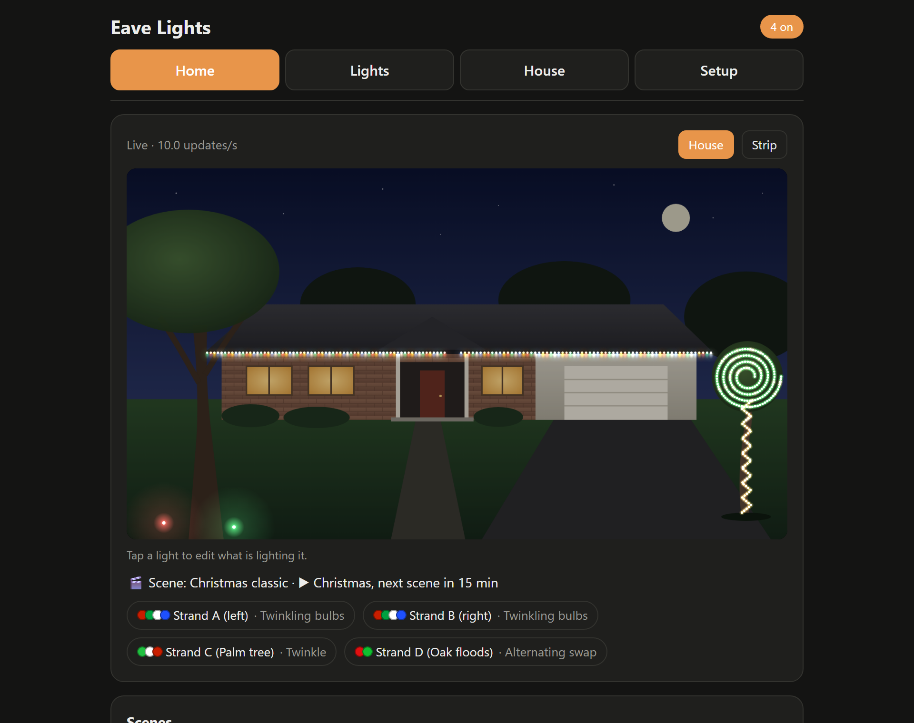
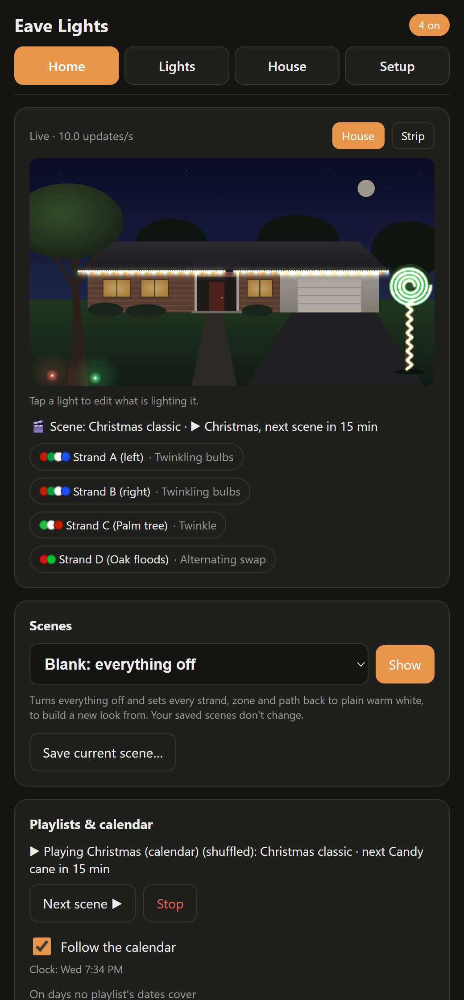
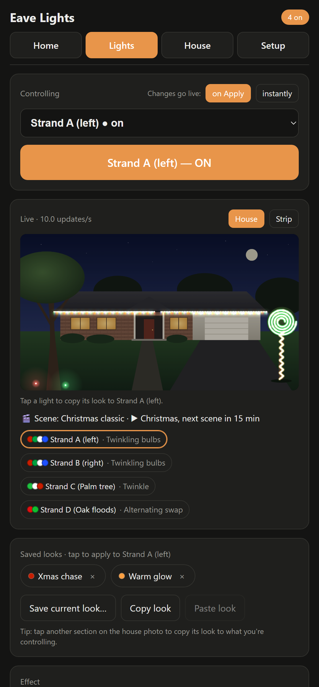
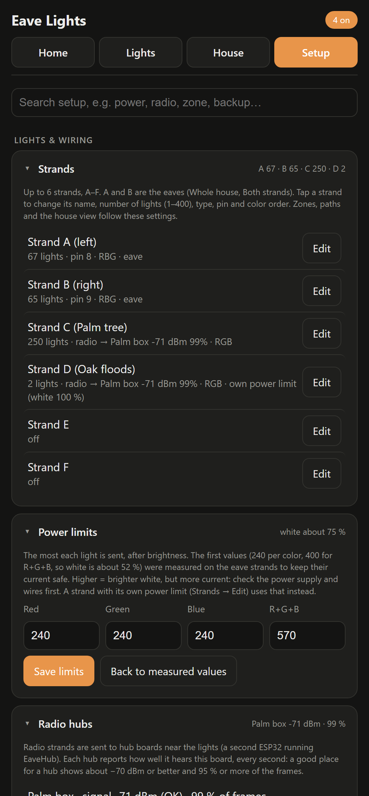

# ESP32 Eave Lights

Wi-Fi controller for addressable (WS2811) house lights, running on an ESP32-S3. It replaces the original Bluetooth controller of the eave puck lights and adds yard lights (a palm tree, flood lights on the oak) through a second "hub" board connected by radio.

Everything is controlled from a web page on any phone or PC on the home network: **http://eavelights.local** (or the board's IP address). The lights run on their own: the page is only needed to change things.

Current firmware: **v0.41.2** · Hub: **1.1.0**

| Home | Lights | Setup |
|---|---|---|
|  |  |  |

Screenshots of the real page with sample settings on a made-up house (remake them with `Docs/images/demo/make_screenshots.sh`).

---

## What it does

- **Up to 6 strands, A–F.** A and B are the eaves (67 + 65 lights, GPIO 8 and 9). C–F are extra strands: wired to a pin of this board, or sent by radio to a hub near the lights. Up to 400 lights per strand.
- **28 effects:** solid, fade, chase, comet, meteor, bounce, center out/in, running lights, color wipe, rainbow wave and cycle, gradient, stripes/candy cane, alternating, sway, twinkling bulbs, glitter, blink & shift, color cycle, twinkle, sparkle, fire, lightning, strobe, drifting leaves, plus **hand-painted lights** and **your own animations**.
- **Up to 5 colors per effect,** a background color, speed, size, brightness, direction (including random), and a "randomness" setting that makes timed effects less mechanical.
- **Zones:** named groups of lights (e.g. Porch = B1-18), each with its own effect, drawn on top of the strands. A zone can be **never lit** (e.g. the lead-in running down the wall) or a **mirror of** another zone (e.g. a tree wound up and back down).
- **Paths:** run one effect through several zones in your order, with reversed parts and gaps (jumps).
- **Whole house:** one line across the front (B65 → B1, A1 → A67) for sweeping effects.
- **Scenes:** a snapshot of everything (e.g. "Falling leaves"), up to 64, grouped by holiday.
- **Playlists and calendar:** scenes with times, looping or shuffled, with yearly dates (e.g. Christmas playlist Dec 1–Jan 6). The calendar starts the right playlist by itself.
- **On/off timer:** at sunset/sunrise (± minutes) or set times. Pressing Play or switching lights on outside the timer's hours keeps them on for 2 hours.
- **House view:** photos of the house with the lights drawn on them, glowing live as they really are. Tap a light to control what's lighting it.
- **Live view:** the exact colors being sent, on the house photo or as a strip, plus a list of what's lit and which scene and playlist are playing.
- **Preview before applying:** changes can be tried on the live view first, then Applied or Discarded.
- **Power limits:** keep the current within what the power supply and wires can take, globally or per strand.
- **Wireless updates** from the Arduino IDE or the web page; **backup and restore** of everything in one file.

---

## The control page

| Tab | What's there |
|---|---|
| **Home** | Live view (house photo or strip), what's lit, scene picker (Show), playlists and calendar, All lights off / on, the on/off timer |
| **Lights** | Pick what to control (a strand, Both strands, Whole house, a path or a zone), its effect, colors and settings, saved looks, Copy/Paste look, painting tools. Changes can wait for **Apply**. |
| **House** | The house photo editor: add photos, draw each section along the eave, set where its lights are |
| **Setup** | All settings, grouped, with a **search box** at the top (type e.g. *power*, *radio*, *zone*, *backup*) |

### Setup

Each topic is its own fold-out, showing its status on the closed header.

**Lights & wiring**
- **Strands:** one row per strand A–F. Edit: name, number of lights (1–400), type (**Off / Wired / Radio**), pin (GPIO), color order (RGB, RBG, GRB…), and an optional own power limit. A new pin starts after a restart (a Restart button appears).
- **Power limits:** the most each light is sent, for all strands without their own limit. The starting values (240 per color, 400 for R+G+B, white ≈ 52 %) were measured on the eaves. *Back to measured values* resets them. With both eave strands on a 24 V 5 A supply, keep R+G+B at about 570 or less (≈ 4 A at full white).
- **Radio hubs:** every hub heard, with its signal (dBm) and % of frames received, refreshed every 3 s while open: good for a range test from a phone. Radio speed: **Long range** (1 Mbps, up to 25 frames/s) or **Fast** (6 Mbps, 50 frames/s, shorter reach).
- **Board LED (test light):** the board's own small RGB LED copies one light (e.g. a flood light) to try effects without the real lights.

**Layout**
- **Zones:** name + lights, e.g. `A1-12, B30-65`. `A12-1` runs backwards. Options: *Never light*, *Mirror of*. Click a zone to flash it white for 10 s.
- **Paths:** zones in order, each optionally reversed, with gap lights after it.
- **Find a light:** lights one chosen light (green) so you can see where it is.

**Colors**
- **Saved colors:** up to 12, offered in every color picker and as painting swatches.

**System**
- **Backup & restore:** one file with everything (zones, paths, looks, scenes, playlists, paintings, animations, photos, strand and power settings, timer). **Download one after every big change.**
- **Firmware update:** upload a `.bin` (Sketch → Export compiled Binary) with the update password.
- **Restart.**

---

## Hardware

| Part | Details |
|---|---|
| Board | ESP32-S3-WROOM-1 **N16R8** dev board (16 MB flash, 8 MB PSRAM), two USB-C ports: use the **COM/UART** one (CH343 chip) |
| Eave strands | WS2811 puck lights, **24 V**, color order **RBG**. A = 67 lights on GPIO 8, B = 65 lights on GPIO 9 |
| Power | 24 V supply for the eaves. Lights are sent OFF at power-up (they otherwise start white) |
| Data | 3.3 V from the board; a 74AHCT125 buffer + ~330 Ω per data line is recommended for long-term use |

Pins that can't be used for lights: 0, 3, 45, 46 (boot), 19–20 (USB), 26–37 (flash and PSRAM), 43–44 (serial), 48 (board LED).

### Hub board (yard lights)

A second ESP32-S3 near the yard lights runs [EaveHub/EaveHub.ino](EaveHub/EaveHub.ino). It receives radio strands from the eave board by **ESP-NOW**: no router, no Wi-Fi password, no pairing.

- At the top of the sketch set `HUB_NAME`, and which strand letters it drives on which pins (default: C on GPIO 8, D on GPIO 9).
- On the control page set those strands to **Radio**.
- It finds the eave board's Wi-Fi channel by itself and reports its signal every second (Setup → Radio hubs).
- If the signal stops, it holds the picture 3 s, then fades out.
- Board LED: blue blink = looking, red blink = signal lost, otherwise it copies light 1 of strand D.
- Several hubs can run at once (up to 4 tracked), each with its own strand letters.
- Hub power: 24 V → 5 V step-down from the lights' supply. Connect all grounds together.
- Tested indoors through walls at about −80 dBm with 100 % of frames.

Planned yard lights: palm tree on strand C (ALITOVE 24 V WS2811 bullets, 250 lights) and oak floods on strand D (30 W WS2811 pixel floods: brown = +24 V, **blue = GND**, yellow = data).

---

## Building and uploading

Uses a **portable Arduino IDE 1.8.19** with ESP32 core 3.3.12 and FastLED 3.10.10. Details, command-line builds and code rules: [AGENTS.md](AGENTS.md).

1. Copy `secrets.example.h` to `secrets.h` and fill in the home Wi-Fi, hotspot password and update password. `secrets.h` is never committed.
2. Board settings (Tools menu):

   | Setting | Value |
   |---|---|
   | Board | ESP32S3 Dev Module |
   | USB CDC On Boot | Disabled |
   | Flash Size | 16MB (128Mb) |
   | Partition Scheme | 16M Flash (3MB APP/9.9MB FATFS) |
   | PSRAM | OPI PSRAM |

3. First upload over USB (COM port of the CH343). After that, upload over Wi-Fi: Tools → Port → **eavelights at …** (network port), using the update password.
4. The hub sketch is uploaded over USB (it isn't on the home Wi-Fi). Open `EaveHub/EaveHub.ino` on its own, with the same board settings.

If the home Wi-Fi can't be reached, the board starts its own hotspot (**EaveLights**, page at http://192.168.4.1) and keeps retrying the home network.

---

## Troubleshooting

| Problem | Fix |
|---|---|
| Page blank | Open the browser Console (F12) and send the red error. |
| Page looks like an older version | Reload (since v0.41.1 the board tells browsers not to keep old copies; before that, close and reopen the page). |
| Board restarts in a loop with `partition 3 invalid … exceeds flash chip` | It was built with Flash Size 4MB: set 16MB and upload again. |
| Hub keeps "Looking for the eave board" | At least one strand must be set to **Radio** (the eave board only sends then). Check both boards are on matching versions. |
| Radio % of frames low | Move the hub or the eave board for a clearer path (metal garage doors block a lot), use external-antenna boards (WROOM-1U), or wire the strand instead (Cat6 + RS485). |
| Scene changes by itself | A playlist or the calendar is playing; showing a scene by hand stops it for the day. |
| Lights dimmer than expected | Setup → Power limits (or the strand's own limit). |

---

## Project files

- [AGENTS.md](AGENTS.md): how the code is organized, build commands, rules for changing it.
- [Docs/ESP32_House_Eave_Lights_Handoff.md](Docs/ESP32_House_Eave_Lights_Handoff.md): hardware facts, measurements, decisions and current state.
- `ESP32_Eave_Lights.ino` + one `.ino` tab per task; the web pages are in `web_page.h` and `editor_page.h`.
- `EaveHub/`: the hub board's sketch.
